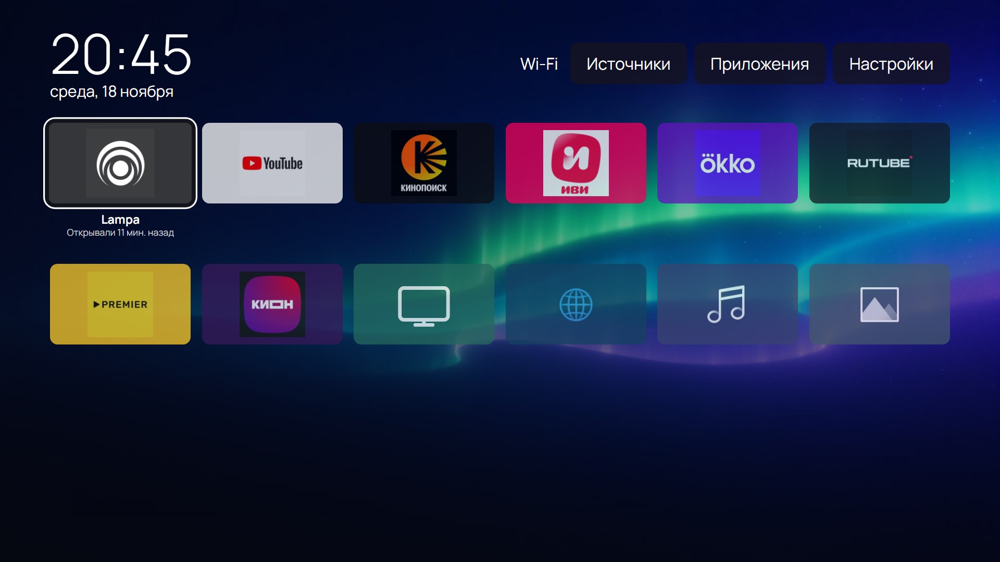

# CleanHome TV для Android TV и LG webOS

В сборках этого форка Android TV и LG webOS используют один интерфейс. Главная, подпись выбранной карточки, библиотека, ручная сортировка, обои и настройки берутся из одного набора исходников. Значки приложений и доступные входы предоставляет сам телевизор. [Оригинальный CleanHome TV](https://github.com/ungurenko/cleanhome-tv)

| Устройство | Что установить | Где проверено |
| --- | --- | --- |
| **LG Smart TV с webOS** | [Скачать IPK 0.4.3](https://github.com/kavabunga6/cleanhome-tv/releases/download/tv-ui-2/dev.cleanhome.tv.webos_0.4.3_all.ipk) · [Установка и управление](webos/README.md) | **LG 55NANO866NA**, версия SDK по данным ТВ **5.6.2**. На других моделях с Developer Mode совместимость требует проверки. |
| **Android TV / Google TV и совместимые Android-прошивки** | [Скачать APK 4.7.1](https://github.com/kavabunga6/cleanhome-tv/releases/download/tv-ui-2/CleanHome-TV-4.7.1.apk) | Общий интерфейс проверен на TCL 55C6K и эмуляторе Android TV 14. Исходную Android-версию автор проверял на Tuvio STV-43FDUBK1R и Яндекс ТВ Станции MiniLED (YaOS). |

## Что добавлено для LG

- **Сетка на главной.** В «Настройки → Сетка главного экрана» выберите число плиток в ряду стрелками. Размер карточек сразу меняется на главной. «Авто» подбирает число колонок по ширине экрана. Под выбранной карточкой видны название и время последнего запуска из CleanHome.
- **Каталог с телевизора.** После однократного разрешения CleanHome получает установленные приложения и их значки. Когда вы ставите или удаляете приложение, каталог обновляется на LG без участия компьютера.
- **Два способа сортировки.** Перетащите карточку указателем Magic Remote или возьмите её кнопкой OK и переставьте стрелками. За один вход можно расставить несколько приложений.
- **Запуск на webOS.** CleanHome TV появляется среди приложений LG. Кнопка Home на проверенном телевизоре открывает системный экран LG.

## Установка общей версии на Android TV

Скачайте APK из таблицы выше. На телевизоре с включённой отладкой выполните `adb install -r CleanHome-TV-4.7.1.apk` и откройте «Главный экран» в списке приложений. При установке поверх версии с другой подписью Android выдаёт `INSTALL_FAILED_UPDATE_INCOMPATIBLE`. Удаление ранее установленной версии стирает её локальные настройки.

Порт использует системный Android WebView. Источники HDMI, список приложений, запуск и дополнительные настройки обслуживает Android. На проверенном TCL 55C6K Android присваивает CleanHome роль домашнего экрана, однако системное нажатие Home открывает Google TV.

### Сборка APK

Из корня проекта выполните `.\gradlew.bat :app:assembleRelease` (Windows) или `./gradlew :app:assembleRelease` (macOS/Linux) с JDK 17 и Android SDK 34. Файл появится в `app/build/outputs/apk/release/`. Gradle упаковывает ту же сцену из `webos/app/`, что и сборщик IPK.

## Android-версия оригинального проекта

Лаунчер (главный экран телевизора) в стиле Apple TV: часы, крупная «сцена» с названием выбранного приложения,
док любимых приложений, свои обои с превью и плавная подсветка. Без рекламы, рекомендаций и баннеров.

Александр Унгуренко собрал Android-версию на основе открытого проекта [CleanYourTV](https://github.com/Gathin23/cleanyourtv) (MIT). Автор использовал DeepSeek Harness и Claude Code и проверил результат на двух телевизорах:

- **Tuvio STV-43FDUBK1R**: Android 9, 1,5 ГБ памяти по паспорту. По наблюдениям автора, с CleanHome телевизор стал заметно шустрее.
- **Яндекс ТВ Станция MiniLED**: Android 14 (YaOS). Отладка у неё закрыта, лаунчер ставится через браузер телевизора.

Как это было, с замерами и ошибками: [статья в блоге](https://blog.ungurenko.ru/svoy-launcher-android-tv) и [на vc.ru](https://vc.ru/ai/3244864-svoy-launcher-dlya-android-tv).



<a id="android-install"></a>

## Установка на Android TV одним промптом

Ставить руками не нужно. Откройте Claude Code, Codex или другого ИИ-агента на компьютере, который подключён к той
же Wi-Fi сети, что и телевизор, и вставьте:

```text
Установи мне лаунчер CleanHome на телевизор: https://github.com/ungurenko/cleanhome-tv
Прочитай AGENTS.md в репозитории и действуй по нему.
Телевизор: <марка и модель>, он в той же Wi-Fi сети, что и этот компьютер.
Я не программист: объясняй простыми словами, что нажимать на пульте.
```

Агент скачает готовый файл, найдёт телевизор в сети, выберет способ установки и подскажет, какие кнопки нажать на
пульте. Подробная инструкция для агента лежит в [AGENTS.md](AGENTS.md).

## Возможности Android-версии

- **Экран «Сцена»**: крупное название выбранного приложения на фоне обоев, под ним «Открывали 13 минут назад».
- **Шрифты с кириллицей** (Manrope, Unbounded) и док по умолчанию с привычными сервисами: Кинопоиск, YouTube,
  VK Видео, RUTUBE.
- **Обои с превью**: экран выбора с миниатюрами и пункт «Обои» прямо в меню настроек (удерживайте «Настройки»).
- **Новый экран настроек** с живым предпросмотром главного экрана.
- **Имя Wi-Fi сети** на главном экране вместо значка.
- **Быстрый холодный запуск**: на Tuvio лаунчер открывается за 0,68 с вместо 1,05 с. Все замеры в
  [PERFORMANCE-REVIEW.md](PERFORMANCE-REVIEW.md).
- **Встроенный счётчик кадров** в меню настроек, чтобы проверить плавность на своём телевизоре.
- **6 обоев**, нарисованных локальной нейросетью MOSS-Image специально для этой версии.


| Настройки | Выбор обоев |
|---|---|
|  |  |

## Как вернуть родной экран

Всё обратимо. Удалите приложение «Главный экран» в настройках телевизора (Приложения → «Главный экран» → Удалить),
и родной экран вернётся. Прошивка телевизора не меняется.

## Своими руками, без агента

1. Скачайте `CleanHome-*.apk` со страницы [Releases](https://github.com/ungurenko/cleanhome-tv/releases/latest).
2. **Если на телевизоре включается отладка по сети**: `adb connect <ip-телевизора>:5555`, затем
   `adb install -r CleanHome-*.apk` и `adb shell cmd package compile -m speed -f com.gathin.tvhome` (ускоряет запуск).
3. **Если отладка закрыта** (например, Яндекс ТВ Станции): `python3 scripts/serve-apk.py CleanHome-*.apk`, откройте
   показанный адрес в браузере телевизора, скачайте и установите файл.
4. Откройте «Главный экран» и разрешите ему стать главным экраном.

## Меняйте под себя

Главная идея: это ваш экран. Скажите агенту, что хотите поменять, например «поставь мои фото в обои», «добавь
в док Okko» или «сделай часы крупнее». Он поправит код, соберёт новую версию и поставит её на телевизор. Как
устроены настройки и сборка, агент прочитает в [AGENTS.md](AGENTS.md).

## Лицензии и благодарности

- Код: MIT, как и оригинальный [CleanYourTV](https://github.com/Gathin23/cleanyourtv) от Gathin. Текст в [LICENSE](LICENSE).
- Шрифты Outfit, Manrope, Unbounded: SIL Open Font License 1.1, [FONT-LICENSE-OFL.txt](FONT-LICENSE-OFL.txt).
- Иконки праздничных тем: Microsoft Fluent Emoji (MIT), [ICONS-LICENSE-FLUENT-EMOJI.txt](ICONS-LICENSE-FLUENT-EMOJI.txt).
- Названия и логотипы сервисов принадлежат их владельцам.

---

**English.** CleanHome is a personal fork of the CleanYourTV Android TV launcher, built entirely by AI coding agents:
an Apple TV style «Scene» home, Cyrillic fonts, a wallpaper picker with previews, a settings screen with a live
preview and a 35% faster cold start on a 1.5 GB Android 9 TV. To install, paste the prompt above into Claude Code or
Codex; the agent follows [AGENTS.md](AGENTS.md) and installs over ADB, or through the TV browser where ADB is locked.
