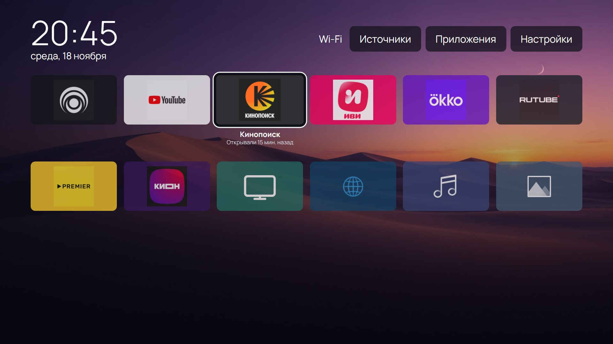
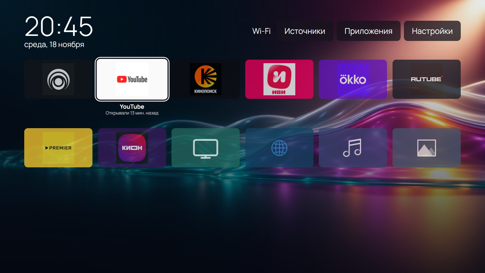
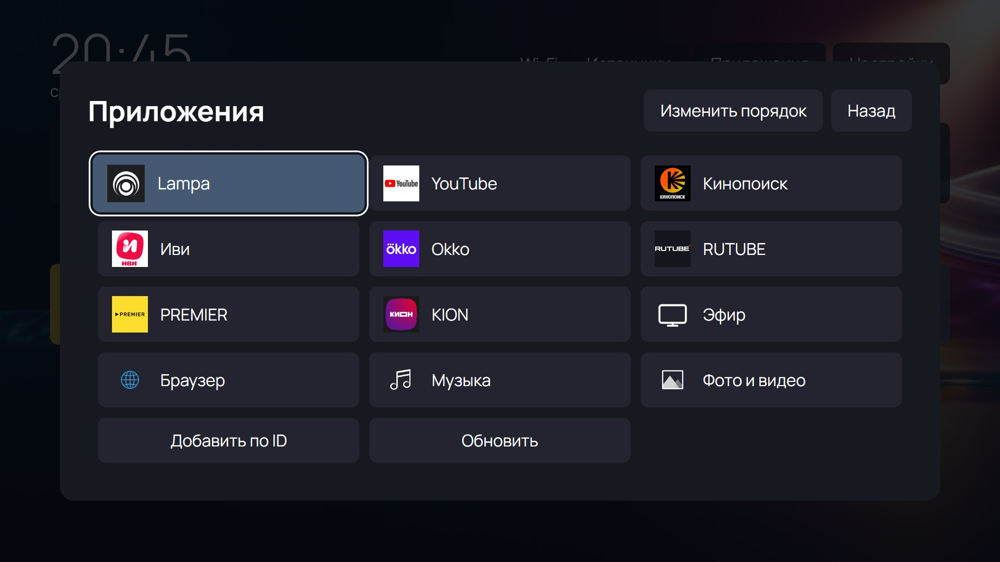
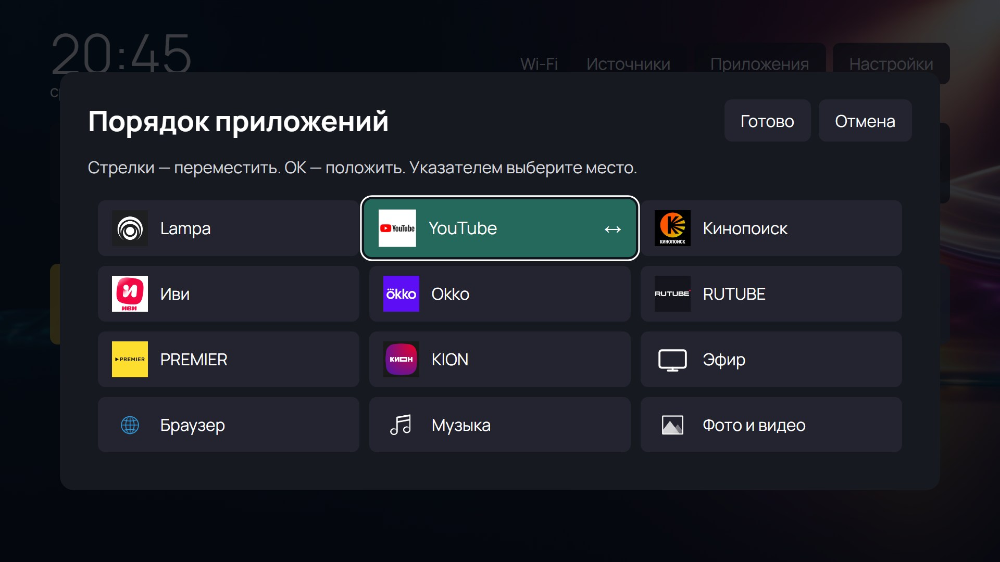
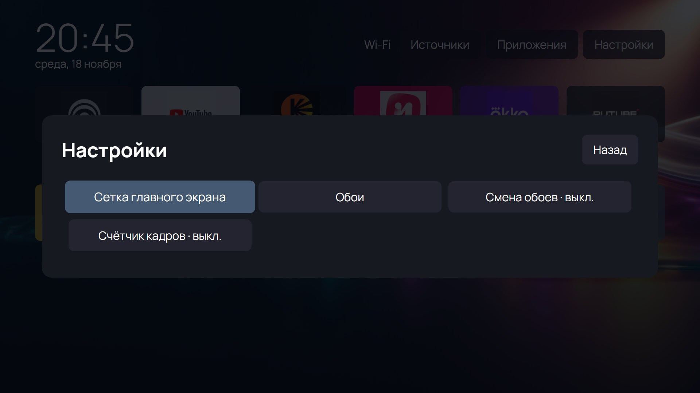
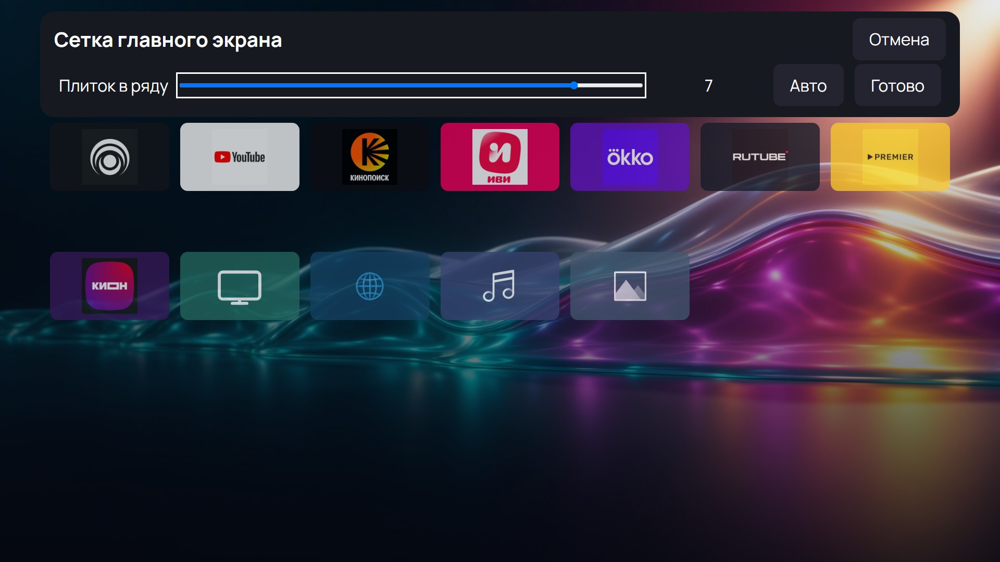
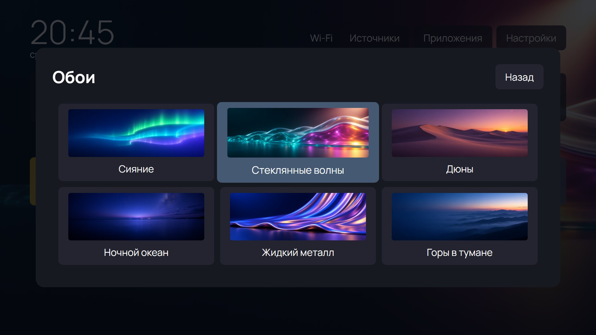

# CleanHome TV для Android TV и LG webOS

В сборках этого форка Android TV и LG webOS используют один интерфейс. Главная, подпись выбранной карточки, библиотека, ручная сортировка, обои и настройки берутся из одного набора исходников. Значки приложений и доступные входы предоставляет сам телевизор. [Оригинальный CleanHome TV](https://github.com/ungurenko/cleanhome-tv)

| Устройство | Что установить | Где проверено |
| --- | --- | --- |
| **LG Smart TV с webOS** | [Скачать IPK 0.4.5](https://github.com/kavabunga6/cleanhome-tv/releases/download/tv-ui-4/dev.cleanhome.tv.webos_0.4.5_all.ipk) · [Установка и управление](webos/README.md) | **LG 55NANO866NA** (SDK 5.6.2) и **LG 43UA73006LA** (SDK 10.3.2). На других моделях с Developer Mode совместимость требует проверки. |
| **Android TV / Google TV и совместимые Android-прошивки** | [Скачать APK 4.7.3](https://github.com/kavabunga6/cleanhome-tv/releases/download/tv-ui-4/CleanHome-TV-4.7.3.apk) | Общий интерфейс проверен на TCL 55C6K и эмуляторе Android TV 14. Исходную Android-версию автор проверял на Tuvio STV-43FDUBK1R и Яндекс ТВ Станции MiniLED (YaOS). |

## Управление на LG и Android TV

На главном экране или в библиотеке удерживайте OK на карточке примерно полсекунды. Откроется «Порядок приложений» с уже выбранной карточкой. Отпустите OK, переместите её стрелками и нажмите OK, чтобы положить. «Готово» сохраняет весь порядок, «Назад» отменяет перестановки. На LG карточку также можно перетащить указателем Magic Remote.

## Главная и каталог

- **Сетка на главной.** В «Настройки → Сетка главного экрана» выберите число плиток в ряду стрелками. Размер карточек сразу меняется на главной. «Авто» подбирает число колонок по ширине экрана. Под выбранной карточкой видны название и время последнего запуска из CleanHome.
- **Каталог с телевизора.** После однократного разрешения CleanHome получает установленные приложения и их значки. Когда вы ставите или удаляете приложение, каталог обновляется на LG без участия компьютера.
- **Запуск на webOS.** CleanHome TV появляется среди приложений LG. Кнопка Home на проверенном телевизоре открывает системный экран LG.

## Установка общей версии на Android TV

Скачайте APK из таблицы выше. На компьютере выполните `adb devices -l`, выберите серийный номер подключённого телевизора и подставьте его вместо SERIAL в `adb -s SERIAL install -r CleanHome-TV-4.7.3.apk` и откройте «Главный экран» в списке приложений. При установке поверх версии с другой подписью Android выдаёт `INSTALL_FAILED_UPDATE_INCOMPATIBLE`. Удаление ранее установленной версии стирает её локальные настройки.

Если доступен системный Android WebView, APK открывает общую сцену. На устройствах без WebView используется отдельная нативная сетка Android. Источники HDMI, список приложений, запуск и дополнительные настройки обслуживает Android. На проверенном TCL 55C6K Android присваивает CleanHome роль домашнего экрана, но без службы CleanHome нажатие Home открывает Google TV. На этой модели возврат из YouTube и системных настроек проверен со включённой службой «Кнопка „Домой“» и параметром `stock_home_redirect`, равным `com.google.android.apps.tv.launcherx`.

При беспроводной отладке откройте её в настройках разработчика. Выполните `adb pair IP:ПОРТ_СОПРЯЖЕНИЯ` и введите код с экрана. Для `adb connect IP:ПОРТ_ПОДКЛЮЧЕНИЯ` возьмите адрес с основного экрана беспроводной отладки. После установки откройте CleanHome и подтвердите запрос роли домашнего приложения. Если назначение уже было пропущено, выберите CleanHome в системных настройках приложений по умолчанию. На TCL, где Home всё ещё возвращает Google TV, откройте системные настройки специальных возможностей и включите службу CleanHome «Кнопка „Домой“». Проверьте Home из YouTube.

Для установки через браузер телевизора на компьютере запустите `python scripts/serve-apk.py CleanHome-TV-4.7.3.apk`, откройте показанный адрес на телевизоре и установите файл. После загрузки остановите сервер сочетанием Ctrl+C.

### Android без WebView

APK автоматически открывает нативную сетку. Стрелки выбирают карточку, OK запускает приложение. Удержите OK для перестановки, перемещайте карточку стрелками и положите её коротким OK. После этого можно поднять следующую. Назад завершает нативную сортировку и сохраняет порядок. Размер сетки задаётся числом колонок в настройках лаунчера.

### Сборка APK

Из корня проекта выполните `.\gradlew.bat :app:assembleRelease` (Windows) или `./gradlew :app:assembleRelease` (macOS/Linux) с JDK 17 и Android SDK 34. Файл появится в `app/build/outputs/apk/release/`. Gradle упаковывает ту же сцену из `webos/app/`, что и сборщик IPK.

## Как выглядит интерфейс

| Главная с Кинопоиском | Главная с YouTube |
| --- | --- |
|  |  |
| **Библиотека** | **Перестановка приложений** |
|  |  |
| **Настройки** | **Число колонок** |
|  |  |
| **Выбор обоев** | **Коллекция обоев** |
|  |  |

Снимки общей сцены сделаны с демонстрационным каталогом. На телевизоре набор приложений зависит от того, что установлено.

## Обновление и возврат к штатному экрану

На Android установите APK с той же подписью поверх существующего. Для возврата выберите прежнее домашнее приложение в системных настройках и отключите службу CleanHome «Кнопка „Домой“», если включали её. Проверьте Home из другого приложения перед удалением CleanHome. На LG порядок обновления, продления Developer Mode и удаления описан в [руководстве webOS](webos/README.md).

## Для разработчиков

[Карта исходников и состояний](docs/STATE-MACHINES.md) · [Проверка производительности](PERFORMANCE-REVIEW.md) · [Сборка и тестирование](AGENTS.md)

## Лицензии и благодарности

- Код: MIT, как и оригинальный [CleanYourTV](https://github.com/Gathin23/cleanyourtv) от Gathin. Текст в [LICENSE](LICENSE).
- Шрифты Outfit, Manrope, Unbounded: SIL Open Font License 1.1, [FONT-LICENSE-OFL.txt](FONT-LICENSE-OFL.txt).
- Иконки праздничных тем: Microsoft Fluent Emoji (MIT), [ICONS-LICENSE-FLUENT-EMOJI.txt](ICONS-LICENSE-FLUENT-EMOJI.txt).
- Названия и логотипы сервисов принадлежат их владельцам.
